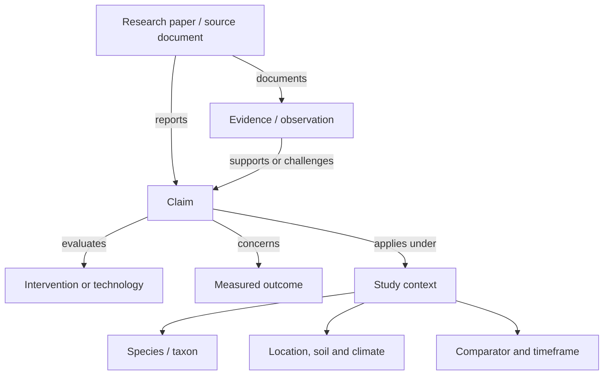
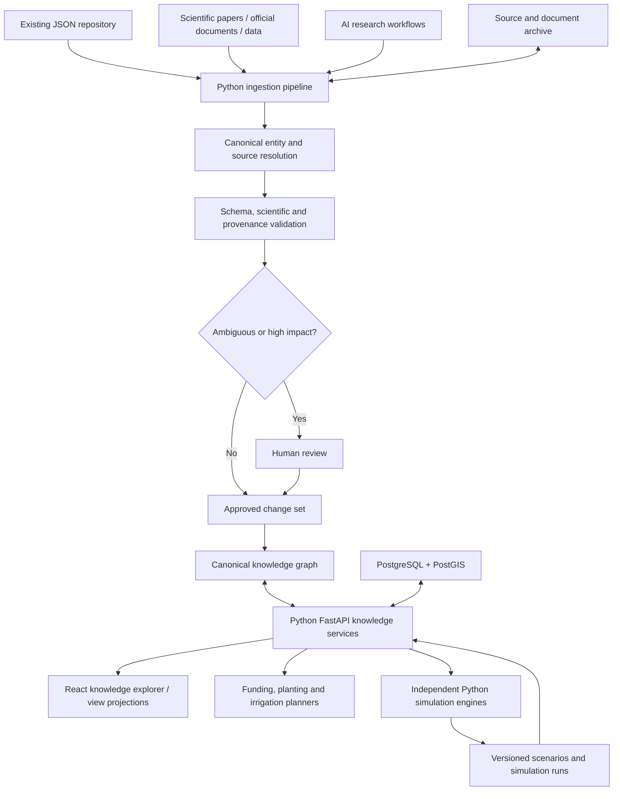
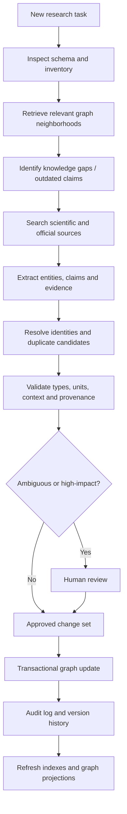
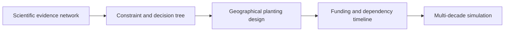

# AI-Maintained Scientific Knowledge Graph and Visual Knowledge Exploration Platform

**Architecture research report**  
**Date:** 5 November 2026  
**Domain:** Ecological restoration, reforestation, scientific knowledge, funding, planting and irrigation technologies, remote sensing, simulations, and visual exploration  
**Preferred application architecture:** Python / FastAPI backend; React frontend  
**Status:** Architecture assessment and proof-of-concept plan; not an implemented system

> **Scope and evidence note:** This report consolidates the research and recommendations developed in the conversation. Vendor, maintenance, pricing, and licensing observations are snapshots from that research, not guarantees; recheck current official terms before procurement or commercial use. Architectural scores below are reasoned estimates, not measured benchmarks. Examples explicitly described as hypothetical are not statements of scientific fact. Documentation and demo links are collected at the end.

---

## Executive conclusion

The strongest direction for the project is an **evidence-aware knowledge graph with multiple visual representations**, maintained by Python research agents and accessible to independent planning and simulation applications.

The goal is not simply to build a database of facts. The system must distinguish:

- **What exists** (species, techniques, technology, organizations, parcels, equipment, programmes).
- **What is claimed** about those things.
- **What has been observed or measured** and by whom.
- **Under which conditions** an observation or claim applies.
- **How reliable or uncertain** the evidence is.
- **What conclusions can legitimately be drawn** for projects, eligibility decisions, and simulations.

The system should separate three principal concerns:

1. **Knowledge storage:** an interconnected representation of research papers, scientific findings, species, technologies, funding programmes, regulations, and relationships.
2. **Knowledge maintenance:** AI-assisted research workflows that discover information, inspect existing knowledge, resolve identities, reject duplicates, preserve sources, validate proposed changes, and maintain relationships.
3. **Knowledge exploration and application:** a user interface that can transform the same underlying knowledge into networks, taxonomies, maps, timelines, decision trees, engineering editors, and inputs to planning or simulation systems.

A crucial distinction is that **a knowledge graph is a data model, not a particular graph layout**. The user should be able to change layouts or derive an entirely different visualization without changing the underlying facts and claims.

### Initial technology recommendation

| Layer | Leading recommendation | Why |
|---|---|---|
| Primary graph database | **Neo4j Community Edition**, initially | Mature graph model, understandable Cypher queries, Python driver, relatively low-friction prototyping |
| Strongly typed alternative | **TypeDB** | Multi-participant relations, role-based schema, strong semantic constraints |
| Standards-based alternative | **Oxigraph + RDFLib + pySHACL** | RDF, SPARQL, formal ontologies and standards-based interchange |
| API and domain services | **Python + FastAPI + Pydantic** | Keeps knowledge processing, validation and application logic in Python |
| Agent orchestration | **LangGraph**, or an equivalent explicit Python workflow | Controlled steps, checkpointing, human review and auditable updates |
| General graph explorer | **React + AntV G6** | Diverse graph layouts, clusters, interaction and transitions |
| Alternative graph explorer | **Cytoscape.js** | Mature graph interaction model, extensions, compound nodes |
| Dense-network benchmark | **Sigma.js + Graphology** | WebGL-based rendering for larger networks |
| Editable planners and engineering flows | **React Flow** | Custom nodes, edges and interactive engineering/workflow editors |
| Geospatial data and interface | **PostgreSQL/PostGIS + MapLibre GL JS** | Parcel geometries, spatial operations and maps |
| Charts | **Vega-Lite** | Declarative statistical and analytical visualization |
| Simulations | **Independent Python engines** | Traceable mathematical models with explicit parameters and versioned results |

**Recommended first experiment:** implement the same small knowledge model in Neo4j and TypeDB behind an identical FastAPI interface, plus a narrower RDF/Oxigraph interoperability prototype. Feed the same graph-view data to G6 and Cytoscape.js. Choose the long-term stack based on evidence expressiveness, correctness, integration effort, editing needs and maintenance—not on rendered network appearance or raw query speed alone.

Avoid two common starting mistakes: (1) making a vector index of documents the authoritative knowledge base, and (2) allowing an AI agent to write arbitrary nodes and edges directly. Semantic similarity is useful for candidate discovery, but it is neither canonical identity nor proof of a scientific relationship.

---

## 1. Technology landscape and 2026 considerations

The initial investigation identified several points worth treating explicitly in an architecture decision:

- **Neo4j** remains an established option, with a maintained Python driver and uniqueness constraints in the Community Edition. Certain stricter schema constraints, such as property-existence, property-type and key constraints, belong to Enterprise features. Plan application-level validation regardless of database choice.
- **TypeDB 3.x** offers a free, open-source Community Edition under MPL 2.0, Python integration and typed relationships with roles. It is particularly attractive for nuanced scientific and regulatory models.
- **Oxigraph** is an actively maintained RDF store with Python access and SPARQL support; the earlier review identified an October 2026 Python package release.
- **ArangoDB's Community licensing** requires careful review for commercial production. Its JSON-plus-graph model is attractive, but it is not an unrestricted substitute for other open-source candidates in every deployment.
- **Kùzu** was archived in October 2025. Community successors such as **LadybugDB** deserve evaluation, but should be treated as less established infrastructure.
- **Apache AGE** remains a PostgreSQL graph extension, yet low upstream project activity reported during 2026 raises maintenance concerns despite releases.
- **Memgraph** is technically relevant, but Community licensing and production-use provisions must be examined for the intended business model.

These are reasons to validate software maintenance, licensing and commercial rights directly before adoption. No technology should win just because it appeared in an older comparison article.

### Why the problem is different from a typical graph app

A conventional graph might store `Species -> USES -> IrrigationMethod`. A scientific knowledge system cannot assume the relation is globally true. It may need to say:

- A particular publication **reports** a finding.
- The finding concerns a particular **species or taxonomic concept**.
- The intervention was tested against a specific **control**.
- The measurement concerned **survival, growth or another outcome**.
- The experiment took place in a specific **climate, soil, geography and timeframe**.
- The paper reports an **effect estimate and uncertainty**, which may differ across studies.

Many-to-many and context-dependent claims are the central design challenge, not network rendering speed.

---

## 2. Comparing knowledge storage approaches

### 2.1 Property graphs

A property graph uses **nodes**, **relationships** and **attributes**. Species, organizations and technologies are nodes; `PART_OF`, `APPLIES_TO` or `DOCUMENTED_IN` may be edges. Query languages such as Cypher support understandable traversals between related entities.

**Strengths:** intuitive representation, good tooling for graph exploration, accessible query model, mature ecosystem, and a relatively direct path from a JSON entity model to graph records.

**Limitations:** sophisticated scientific semantics do not arise automatically. A claim with several participants, conditions, measured results and sources needs a careful schema. Uniqueness constraints are not the same as evidence or scientific consistency checks.

**Leading candidate:** Neo4j.

### 2.2 RDF and semantic-web graphs

The **Resource Description Framework (RDF)** models statements as subject–predicate–object triples, optionally organized in named graphs or datasets. Concept and property identifiers can be globally meaningful IRIs. RDF can work with:

- **RDFS:** class and property vocabulary.
- **OWL:** formal ontology modeling and reasoning.
- **SHACL:** validation of RDF graph data against shapes and constraints.
- **SPARQL:** standard graph query language.
- **SKOS:** controlled vocabularies, labels, concepts and hierarchical relations.
- **PROV-O:** provenance of entities, activities and agents.

**Strengths:** portability, interoperability, scientific standards, stable identifiers, machine-interpretable relations, formal validation, and opportunities to integrate established ontologies.

**Limitations:** steeper modeling and query learning curve; operational and frontend integration require deliberate design; formal reasoning can become difficult to manage; standardization does not by itself establish that a scientific claim is true.

**Leading Python-centered candidate:** Oxigraph/PyOxigraph for storage, RDFLib for graph processing, and pySHACL for validation.

**Important distinction:** RDFLib is a Python library for RDF handling, not an apples-to-apples production graph-server equivalent to Neo4j.

### 2.3 Strongly typed relationship systems

**TypeDB** allows relation types with explicit roles. A scientific experiment can relate an investigator, species, treatment, comparator, location and observation without flattening everything into unrelated binary edges. Its schema controls what types may play particular roles and can express cardinality and attribute restrictions.

**Strengths:** strong structural semantics and typed relationships; attractive for complex scientific relationships and funding eligibility models.

**Limitations:** more specialized ecosystem and data model; custom connectors and visualizations still need to be built; a typed relation can still describe a factually mistaken scientific assertion unless source validation is performed separately.

### 2.4 PostgreSQL and JSONB

PostgreSQL with JSONB, normalized relational tables and link tables may be sufficient for some parts of the project. It provides strong transactions and an easy bridge to existing JSON. PostGIS adds a mature geospatial data model.

**Strengths:** operational maturity, SQL, relational integrity, JSON storage, spatial integration and a large Python ecosystem.

**Limitations:** a rich, dynamically expanding network usually requires custom query logic and graph projections. PostgreSQL is a viable system of record, but a dedicated graph representation may reduce development effort for exploratory network use cases.

**Apache AGE** adds graph querying to PostgreSQL, though its maintenance status warrants investigation.

### 2.5 Multi-model and hybrid systems

ArangoDB combines JSON-like documents and graph traversal, making it conceptually appealing for a JSON-heavy repository. A broader hybrid architecture can use a graph for relationships, a document store for original sources, PostgreSQL/PostGIS for operations and geometry, and vector retrieval for discovery.

The cost is **synchronization complexity**. Each record type must have one clear authoritative owner. Duplicate writes to a graph and document store without transactional coordination will eventually diverge.

### 2.6 Comparison summary

| Approach | Best quality | Main drawback | Fit |
|---|---|---|---|
| Neo4j property graph | Practical querying and graph exploration | Requires custom evidence semantics and validation | Best rapid end-to-end candidate |
| TypeDB | Typed, multi-role relationships | Specialized tooling and integration work | Best type-system comparison |
| RDF/Oxigraph | Open standards and ontological interoperability | Additional modeling overhead | Best standards-based comparison |
| PostgreSQL JSONB + link tables | Operational and JSON simplicity | Custom graph logic | Viable conservative alternative |
| ArangoDB | Documents plus graph | Community licensing restrictions for some commercial uses | Investigate after licensing review |
| Memgraph | Property graph with real-time capabilities | License and product fit require review | Secondary benchmark |
| Apache AGE | Graph queries with PostgreSQL | Project-activity concerns | Conditional candidate |
| LadybugDB | Embedded graph successor ecosystem | Newer maturity profile | Experimental benchmark |

### Preferred decision rule

The winning architecture must support **canonical identity, n-ary contextual claims, temporal validity, provenance, contradictions, controlled mutations, Python access, exportability and comprehensible view projections**. Benchmark these features with the *same domain dataset* rather than comparing marketing checklists.

---

## 3. Scientific and technical knowledge model

Five broad knowledge families provide a manageable organizing principle. They should guide a schema, not necessarily become five rigid database labels.

| Family | Candidate entity types |
|---|---|
| Real-world entities | `Taxon`, `Species`, `Habitat`, `Location`, `LandParcel`, `Organization`, `Equipment`, `Technology` |
| Techniques and processes | `RestorationTechnique`, `IrrigationTechnology`, `EcologicalProcess`, `Experiment` |
| Knowledge and evidence | `ResearchPaper`, `SourceDocument`, `Claim`, `Evidence`, `Observation`, `ExperimentalContext` |
| Institutions and rules | `FundingProgramme`, `FundingCall`, `EligibilityRule`, `LegalInstrument`, `RuleVersion` |
| Planning and simulation | `Project`, `PlantingPlan`, `SimulationModel`, `ModelParameter`, `Scenario`, `SimulationRun` |

### 3.1 Separate an entity, an assertion, and evidence

An **entity** is the thing: for example, *Ceratonia siliqua*, an irrigation method, or a funding call.

A **claim** is a specific assertion about an entity or relation: a treatment has some reported effect under stated conditions. It may be disputed, conditional or no longer supported.

An **observation** is something measured or recorded in an experiment or field study. The original measurement and its units, treatment, comparator, time and uncertainty should be preserved.

**Evidence** links claims to observations, passages, figures, datasets or other source material. A source document can report several independent claims, and different papers can support or challenge the same claim.



*Conceptual diagram. No experimental result is implied by the example.*

A practical `Claim` should include a stable ID, precisely described assertion, participants, applicability context, epistemic status, relationship to other claims, supporting evidence and version history.

A quantitative `Observation` should preserve, when reported, the outcome definition, numerical values, units, uncertainty interval, sample size, experimental design and location in the source. A `SourceDocument` should preserve bibliographic data and an exact evidence locator (page, table, figure, passage or dataset record).

### 3.2 Distinctions that must survive storage and retrieval

- **Association versus causation:** a correlation does not establish causal influence.
- **Measurement versus hypothesis:** experimental observations are not equivalent to proposed mechanisms.
- **Simulation versus reality:** modeled outcomes are predictions, not observed ecosystem states.
- **Scientific claim versus legal rule:** regulatory requirements demand authoritative sources, dates and legal scope.
- **Current versus superseded:** earlier claims and rules should remain inspectable.
- **Absence of evidence versus evidence of no effect:** missing data and a tested null result have different meanings.
- **Extraction confidence versus scientific confidence:** an LLM's certainty in reading a passage is not a measure of the underlying result's reliability.
- **Different results versus contradiction:** findings from different conditions may coexist without logical conflict.

Do not collapse scientific reliability to one arbitrary number. Relevant dimensions can include study design, replication, uncertainty, sample size, methodological limitations, applicability and source quality.

### 3.3 Temporal representation and provenance

For scientific knowledge and especially funding rules, adopt **bitemporal thinking**:

- **Valid time:** when a rule or statement applied in the world.
- **Transaction/knowledge time:** when the system recorded or learned it.

Also track publication dates, retrieval dates, document versions and explicit supersession links as appropriate.

A funding rule might apply from January, be published later, and be imported later still. Those are different events. A project should be able to reconstruct which rules applied on a given application date *and* what the system knew when it made its recommendation.

Use an auditable change history and immutable or append-only source provenance where practical. Correcting a bad extraction should not destroy evidence of the original decision and its correction.

### 3.4 Standard vocabularies and identifiers

| Vocabulary or standard | Where it helps |
|---|---|
| Darwin Core and GBIF | Taxonomic concepts, accepted names, synonyms, biodiversity records |
| ENVO | Environmental systems, habitats, environmental materials |
| AGROVOC | Agriculture-related terms across languages |
| SKOS | Concepts, preferred labels, alternative labels, taxonomies |
| PROV-O | Provenance: sources, agents, activities, derivations |
| Dublin Core | Document metadata |
| QUDT | Physical quantities, dimensions and units |
| GeoSPARQL | Semantic description of geospatial relationships |
| JSON-LD | Semantic identifiers and linked representation in JSON |

Use these selectively. Adopting an entire ontology before the application demonstrates a need can create substantial complexity without improving user outcomes.

Every internal concept needs a **stable identifier independent of its visible name**. English, Spanish and German names should be labels or aliases, not separate concepts. *Ceratonia siliqua*, *algarrobo* and *carob tree* may all refer to one taxon—but matching must respect the appropriate taxonomic authority and concept definition.

---

## 4. Overall architecture



The initial project can run most Python components in one service. These are logical boundaries, not a recommendation to begin with microservices.

### Responsibilities

**Graph database:** canonical concepts, identifiers, relationships, evidence-aware claims, links to source documents, typed applicability and provenance.

**Document archive:** original publications where storage rights permit, official documents, source snippets, retrieved metadata, imported artifacts and extraction outputs.

**PostgreSQL/PostGIS:** operational state, users/projects, land geometry, spatial intersections, potentially costs and financial records. Not every operational object needs to be duplicated in the graph.

**Python services:** ingestion, entity resolution, validation, rules evaluation, graph projections, APIs and simulations.

**React frontend:** interactive graph views, maps, timelines, funding workflows, evidence panels and editable engineering interfaces.

**Python simulation engines:** mathematical and computational models that consume versioned knowledge and produce traceable predictions. They must not treat predictions as observed facts.

### API boundary

An application should request suitable knowledge without depending on database-specific graph query syntax. The frontend should receive a **view projection**, not a dump of every node in the canonical store.

This separation makes it possible to replace Neo4j with a different engine, or to serve the same knowledge to new tools, without rewriting the scientific domain model.

---

## 5. Visual knowledge exploration

The visualization system should support two different transformations.

1. **Layout transformation:** the same visible nodes and edges change their geometry—from force-directed to radial, circular, hierarchical or clustered.
2. **Semantic projection:** the system derives a new structure from the same knowledge—for example, converting an evidence network into a method comparison, decision tree, map or funding timeline.

The second is the more consequential capability. It requires a view-generation model, not merely a renderer with animation.

### 5.1 Common visual perspectives

| Perspective | User question | Suitable presentation |
|---|---|---|
| Relationship network | What is connected to this idea? | Interactive property graph |
| Taxonomy | Where does this concept belong? | Tree or nested hierarchy |
| Evidence graph | Why should I believe this claim? | Claims, experiments and sources |
| Comparison | Which techniques perform differently? | Structured comparison and charts |
| Decision path | Which choices satisfy the constraints? | Decision tree or logic workflow |
| Geography | Where can an intervention apply? | Map and spatial overlays |
| Temporal perspective | When do events and conditions apply? | Timeline or temporal graph |
| Engineering system | How are components connected? | Editable node-and-edge diagram |
| Funding dependency | Which actions are required before another? | Dependency graph and calendar |
| Simulation | How do future scenarios differ? | Time series, state transitions and uncertainty bands |

### 5.2 Framework candidates

| Framework | Main strengths | Watch-outs | Suggested use |
|---|---|---|---|
| **AntV G6** | Force, radial, tree, circular and clustered layouts; rich interactions and transitions | Custom semantic projections still require application logic | Primary general graph explorer |
| **Cytoscape.js** | Mature graph API, compound nodes, selection, traversal and extensions | Certain advanced layouts or interactions depend on extensions | Leading alternative and benchmark |
| **Sigma.js + Graphology** | WebGL rendering and dense-network exploration | Less optimized for engineering-style node editing | Dense-network benchmark |
| **React Flow** | Editable nodes, edges and workflow/diagram components | Not primarily a large scientific network explorer | Irrigation, funding and simulation editors |
| **yFiles for HTML** | Advanced layout, interaction, graph editing and data quality visualization | Commercial pricing and license terms | Design reference, optional commercial alternative |
| **MapLibre GL JS** | Interactive geographical rendering | Separate spatial/graph synchronization needed | Land and intervention maps |
| **Vega-Lite** | Statistical plots and analytical dashboards | Not a general-purpose network editor | Evidence summaries, finance and simulation trends |

### 5.3 Real interactive references

- **AntV G6 demos:** https://g6.antv.antgroup.com/en/examples/
- **Cytoscape.js documentation and demos:** https://js.cytoscape.org/
- **Sigma.js:** https://www.sigmajs.org/
- **yFiles knowledge graph demo:** https://live.yworks.com/demos/showcase/knowledge-graphs/
- **React Flow examples:** https://reactflow.dev/examples
- **MapLibre GL JS:** https://maplibre.org/maplibre-gl-js/docs/
- **Vega-Lite:** https://vega.github.io/vega-lite/

The yFiles example is particularly relevant as a design reference because it combines graph exploration with identity/duplicate handling, merging and graph correction. It demonstrates that knowledge exploration can include data-quality workflows, not just attractive node layouts. The previously reviewed published yFiles single-developer HTML pricing was around €9,200 per year before VAT; verify current pricing and license terms before considering adoption.

### 5.4 Interaction design principles

A user should be able to:

- Focus on one concept and preserve that focus when switching perspectives.
- Collapse many low-level relationships into meaningful concepts.
- Expand only the selected neighborhood or evidence trail.
- Filter by topic, species, geography, time, evidence, relevance or confidence-related criteria.
- See *why* a connection exists and the source supporting it.
- Compare studies that disagree without silently averaging or hiding them.
- Move between a network, a method comparison, a geographical view and a project timeline.
- Save useful perspectives independently of the underlying data.
- Inspect historic claims and prior rule versions when relevant.
- Edit knowledge through controlled operations distinct from visual layout editing.

Do not initially render an entire large graph. Start with a question-oriented neighborhood and progressively disclose more relationships. **Comprehension is the goal, not maximum node count.**

### 5.5 KnowledgeView as a reusable abstraction

Define a `KnowledgeView` that identifies the focus entity, filters, graph revision, expansion depth, source requirements, projection type and layout settings.

Example response:

```json
{
  "view_id": "species-evidence-network",
  "focus_entity_id": "taxon-uuid",
  "graph_revision": "revision-id",
  "projection": "evidence_network",
  "layout": "radial",
  "nodes": [
    {
      "id": "taxon-uuid",
      "type": "Taxon",
      "label": "Ceratonia siliqua"
    }
  ],
  "edges": [],
  "evidence_refs": [],
  "filters": {
    "language": "en",
    "include_superseded": false
  }
}
```

A funding timeline would use another projection but retain the canonical IDs of calls, programmes, rules and documents. Node positions and layout changes are UI state; they are not mutations to scientific knowledge.

Example endpoints:

```text
GET  /entities/{id}
GET  /entities/{id}/neighborhood
GET  /claims/{id}/evidence
POST /views/project
POST /changesets/propose
POST /changesets/{id}/validate
POST /changesets/{id}/approve
POST /changesets/{id}/commit
```

These are illustrative API contracts rather than an implemented specification.

---

## 6. AI agents and knowledge maintenance

An AI agent should be able to research and organize knowledge, but should not freely modify a canonical scientific database on the basis of language-model output alone.

### 6.1 Proposed workflow



The important object is a **`ProposedChangeSet`**. Research findings become proposed additions or modifications first, not unreviewed database writes.

### 6.2 How an agent can understand existing knowledge

An agent cannot reliably load an indefinitely large knowledge base into its model context before every search. Instead, use staged, schema-aware discovery:

1. Load the current domain schema, supported relationship types and a compact inventory of graph subjects.
2. Search canonical identifiers, aliases and document metadata.
3. Retrieve relevant graph neighborhoods and previously extracted claims.
4. Use semantic search/embeddings to propose additional candidates.
5. Examine relevant evidence and unresolved ambiguities.
6. Research only genuinely new, missing or outdated material.

For a new irrigation topic, retrieve existing techniques, alternative names, source publications, previous findings, experimental contexts and unresolved questions before searching externally. This gives a focused view of the existing knowledge without pretending that one LLM prompt contains everything.

### 6.3 Deduplication has different levels

**Entity duplicate:** two records represent the same real-world concept. Resolve to one canonical identity, preserving aliases and source-specific references.

**Source duplicate:** two files or references identify the same publication. Match DOI or another authoritative ID before fuzzy title matching.

**Claim overlap:** different publications support the same scientific proposition. Preserve the independent sources; do not merge them into one source record.

**Apparent contradiction:** studies concern similar methods but report different results. Compare species, outcome, comparator, environment, time, methodological context and uncertainty before classifying a contradiction.

Use deterministic identifiers first, normalization and metadata second, contextual graph comparison third, and embeddings/LLM assessments as candidate discovery mechanisms—not as sole proof of identity.

Useful external canonical resources include **GBIF** for taxa and **OpenAlex** for scientific works and DOI-based publication resolution.

### 6.4 Recommended agent components

| Technology | Useful role | What it does not solve alone |
|---|---|---|
| Microsoft GraphRAG | Index text into entities, relationships and community summaries | Scientific truth, authoritative merges, complete update governance |
| LlamaIndex PropertyGraphIndex | Structured graph extraction, storage interfaces and graph-aware retrieval | Domain-specific evidence and deduplication policy |
| LangChain LLMGraphTransformer | Constrained extraction into candidate graph records | Factual validity and identity resolution |
| LangGraph | Orchestration, persistent checkpoints, approvals and multi-step workflows | The scientific schema and quality standards |
| Pydantic | Typed Python extraction and structural validation | Scientific interpretation |
| pySHACL | RDF graph validation against shapes | Whether the source claim is accurate |

GraphRAG-style extraction is useful for finding and organizing material, but it should not become the sole authoritative knowledge source. It also introduces LLM indexing cost and model-dependent output. Keep the ingestion process incremental, auditable and reproducible.

### 6.5 Required safeguards

For each proposed mutation, store:

- Source document and exact passage/table/figure locator.
- Extracted assertion and implicated entities.
- Candidate existing entity matches and matching evidence.
- Measurement values, units, context and uncertainties where applicable.
- Validation results and unresolved issues.
- Reason for change and proposed operation (`create`, `link`, `revise`, `merge`, `supersede`, etc.).
- Approval status, reviewer or policy, timestamp and version.

Validate relationship types, role compatibility, required source references, quantity units, temporal logic and canonical uniqueness. Database transactions should enforce consistent writes. Maintain rollback or compensating-change capability and a complete audit trail.

Automating source metadata ingestion is lower risk than automatically merging taxa, changing model parameters, or deciding grant eligibility. Review thresholds should reflect that difference.

---

## 7. Applications built on the shared knowledge system

The graph is the reusable **knowledge foundation**, not the universal computation engine.

| Application | Retrieved knowledge | Separate computation/UI |
|---|---|---|
| Planting planner | Taxa, habitats, environmental requirements, methods and evidence | Python suitability and optimization models, geographical planting plan |
| Irrigation designer | Technology, components, constraints, measured performance | Python water balance and hydraulics, editable engineering diagram |
| Funding planner | Programme/call structure, requirements, dates, authorities | Versioned rules engine, application calendar, financial model |
| Scientific explorer | Publications, claims, experiments and contradictions | Evidence comparison, graph exploration and literature navigation |
| Restoration simulation/game | Ecological relations, parameter estimates and uncertainties | Python simulation engine, scenario UI, time-series outputs |

### 7.1 Funding: discovery is not eligibility

A search agent can identify **potentially relevant** calls, but eligibility must be evaluated against authoritative, dated conditions. Use three outcomes:

- `eligible`
- `ineligible`
- `insufficient_information`

Missing data is not evidence of eligibility. A programme can exist while a particular call is closed, and a rule can have changed between application rounds.

Relevant official source systems include Spain's **Sistema Nacional de Publicidad de Subvenciones y Ayudas Públicas (SNPSAP/BDNS)** and the EU **Funding & Tenders Portal**. The graph should link to official rule documents, preserve their version and validity window, and distinguish official requirements from an LLM's interpretation.

### 7.2 Irrigation and engineering

Graph knowledge can describe technology categories, equipment compatibility, published evidence and context-dependent performance. Actual design requires a computational model using the relevant site, climate, soil, hardware and design constraints.

Do not treat vendor marketing figures, test results from different environments and model predictions as interchangeable. Python should implement the explicit computations, while React Flow or a specialized engineering editor provides interactive system design.

### 7.3 Restoration simulations

A multi-decade model should load versioned biological assumptions, technical interventions, financial rules and uncertainty from the knowledge API. Store a `SimulationRun` with model version, input snapshot, assumptions, stochastic seed where relevant, and outputs.

Simulation outputs are **scenario predictions**, not observational evidence. They can become linked graph objects without becoming established scientific claims.

---

## 8. Three worked examples

### Example A: Scientific exploration beginning with *Ceratonia siliqua*

A user opens the knowledge explorer and searches for *Ceratonia siliqua* (carob tree / algarrobo).

1. Resolve the scientific name to a canonical taxon and relevant external taxonomic identifiers.
2. Retrieve habitat associations, ecological interactions, climate-related research, restoration methods and documented irrigation experiments.
3. Show a relationship network with clear evidence links.
4. Switch to *planting methods* to compare interventions and the contexts in which they were studied.
5. Switch to *evidence* to inspect claims, experiments, papers and conflicting results.
6. Switch to *funding* for potentially applicable programmes, reserving definitive eligibility for project-specific rules evaluation.

An illustrative Cypher query against the proposed Neo4j schema:

```cypher
MATCH (t:Taxon {scientific_name: $scientific_name})
MATCH (c:Claim)-[:ABOUT_TAXON]->(t)
MATCH (c)-[:SUPPORTED_BY]->(e:Evidence)
MATCH (e)-[:DOCUMENTED_IN]->(p:ResearchPaper)
RETURN c.id, c.summary, e.id, p.doi
```

*Illustrative only: the labels, relationship types and query assume a schema not yet implemented.*

The same taxon and claim IDs should appear regardless of whether the user is viewing a network, taxonomy, method comparison or funding projection.

### Example B: An agent finds a new irrigation study

Suppose a research agent discovers a paper evaluating an irrigation method already represented in the graph.

1. Identify the work by DOI and metadata; check whether the document was imported earlier.
2. Resolve the method to an existing canonical technology, reviewing alternate names and related techniques.
3. Extract outcome, units, comparator, species, site, environmental context, measurement period and source locator.
4. Compare the candidate claim to existing claims with similar intervention and outcome definitions.
5. Preserve differences in context and independent sources. Flag a contradiction only where findings are actually comparable.
6. Create a proposed change set and validate it.
7. Send ambiguous merges and high-impact conclusions for review.
8. Commit approved additions transactionally and preserve history.

Illustrative proposal fragment (no real measurements are supplied):

```json
{
  "operation": "propose_claim",
  "subject_id": "irrigation-technique-existing-id",
  "claim_type": "experimental_outcome",
  "source": {
    "paper_id": "resolved-publication-id",
    "evidence_locator": "table-or-passage-reference"
  },
  "context": {
    "taxon_id": "resolved-taxon-id",
    "site_id": "resolved-study-site",
    "comparator_id": "resolved-control-treatment"
  },
  "outcome": {
    "quantity": "measured-outcome",
    "value": null,
    "unit": null,
    "uncertainty": null
  },
  "review_status": "proposed"
}
```

The `null` quantities mean the extraction is not yet complete. They are **not** fabricated observations.

### Example C: Semi-arid restoration project over 30 years

A user creates a hypothetical project linked to a land parcel, environmental conditions, possible species, restoration methods, irrigation techniques, available financing and potential land-access arrangements.

The user explores a sequence of different visual views:



- In the **network**, the user examines what is known about site suitability, techniques and uncertainty.
- In the **decision view**, the application evaluates technical constraints and shows why methods are included or excluded.
- In the **map**, the user places interventions spatially and sees environmental layers.
- In the **funding view**, the system shows possible programmes, eligibility dependencies, deadlines and land-access conditions.
- In the **simulation**, Python computes scenarios over decades using explicit model and funding assumptions.

The fundamental graph concepts and evidence remain persistent throughout; only the view projection and computational use change.

---

## 9. Migrating an existing JSON repository

The most dangerous migration outcome is to create two independently editable sources of truth: the original JSON and a new graph store. Migrate gradually but define which system is authoritative for each record type.

### Proposed migration stages

1. **Inventory JSON.** Catalog object types, identifiers, synonyms, embedded relationships, source metadata, field quality and likely duplicates.
2. **Define a minimum canonical model.** Begin with a small set of entities, relations and source types; add more complex claims where data supports them.
3. **Build a reproducible transformation pipeline.** Parse source JSON into validated Pydantic structures and preserve mappings from original records to canonical IDs.
4. **Resolve identities.** Match exact identifiers and aliases, canonicalize terms and reconcile duplicates.
5. **Import idempotently.** Re-running the importer should not create additional copies of the same entity, source or claim.
6. **Operate in parallel temporarily.** Existing applications can keep reading original JSON or compatibility exports while graph behavior is verified.
7. **Choose canonical ownership.** After validation, authoritative graph changes should generate downstream JSON representations when necessary rather than being independently re-entered.
8. **Version and back up.** Keep schemas, import/export scripts and change history under version control. Test restoration and migration reversal.

### JSON-LD as an interoperability option

JSON-LD can add semantic context, stable identifiers and links to existing JSON without requiring all code to become an RDF application. It is worth testing for records intended to be exchanged across domains or published for reuse.

Not every JSON document deserves conversion to semantic graph data. Application preferences, simulation internals, temporary cache data and UI state may stay in ordinary files or relational storage.

### Single-writer discipline

If the graph is authoritative for a concept, future agent changes should go through the knowledge API. If PostgreSQL is authoritative for parcel geometry or transactional state, the graph should reference canonical IDs and obtain current values through defined interfaces. For any mirrored data, use explicit events, outbox patterns, reconciliation and version tracking where needed.

---

## 10. Weighted architecture assessment

This scorecard is a **subjective engineering assessment**, not a performance measurement. Its purpose is to make assumptions explicit and guide a proof of concept.

### Suggested weights

| Criterion | Weight |
|---|---:|
| Scientific relationship expressiveness | 15% |
| Validation and structural integrity | 15% |
| Python and agent ecosystem | 20% |
| Open standards and interoperability | 10% |
| Migration from existing JSON | 10% |
| Ecosystem and sustainability | 10% |
| Operational simplicity | 10% |
| Licensing and portability | 10% |
| **Total** | **100%** |

A qualitative 1–5 score for each criterion, weighted and converted to 0–100, produced this provisional ordering in the original assessment:

| Candidate | Provisional weighted fit / 100 |
|---|---:|
| Neo4j | 83 |
| Oxigraph + RDF tooling | 81 |
| PostgreSQL with graph tables | 80 |
| TypeDB | 76 |
| Memgraph | 71 |
| ArangoDB | 71 |
| LadybugDB | 71 |
| Apache AGE | 62 |

**Interpretation:** The small gaps between leaders do not establish superiority. Neo4j is a pragmatic first choice because of ecosystem familiarity and integration efficiency. Oxigraph is strong for scientific standards. PostgreSQL is a conservative option for structured application data. TypeDB is unusually strong for typed scientific relationships, but requires additional integration evaluation.

Scores should be replaced by observed results from a standardized proof-of-concept test.

### Explicit licensing and maintenance concerns

- Neo4j Community and Enterprise feature differences affect what validation can be enforced natively.
- TypeDB's open-source Community offering is relevant but should be checked against the intended deployment.
- ArangoDB Community production restrictions and Memgraph licensing terms require commercial-use review.
- yFiles is commercial; React Flow has free core components but some premium examples/templates.
- Apache AGE's project activity and LadybugDB's ecosystem maturity should be reviewed.
- Kùzu itself is archived and should not be selected as new production infrastructure without considering maintained alternatives.

---

## 11. Proof-of-concept benchmark

Build one small but difficult knowledge domain: **species, restoration/irrigation techniques, experimental evidence and a few funding calls**.

### Proposed dataset size

Approximately:

- 25 scientific publications.
- 20 taxa.
- 15 restoration or irrigation techniques.
- 5 funding calls.
- A deliberately varied set of claims, experimental contexts, relationships and evidence.

These are prototype design targets, not necessary production limits.

Include challenging cases:

- Duplicate documents with different metadata.
- Taxonomic synonyms and multilingual labels.
- Different names for the same technique.
- Overlapping and apparently contradictory experimental findings.
- Missing measurements and incomplete publication details.
- Time-dependent funding rules and superseded versions.
- A few ambiguous entity matches requiring review.

### What to compare

**Storage engines:** import the same logical dataset into Neo4j and TypeDB, plus a smaller Oxigraph prototype. Access each through the same domain service contract.

**Visualization libraries:** feed G6 and Cytoscape.js the same `KnowledgeView` projection. Compare layout transitions, clustered views, evidence inspection, filtering, responsiveness and persistence of selected concepts.

**Agent ingestion:** run the same new-paper scenario through candidate extraction, entity resolution, schema checks and change-set review. Check whether repeated runs produce exactly the same canonical records rather than duplicates.

### Evaluation dimensions

1. Identity-resolution correctness and rate of false merges.
2. Preservation of scientific context, measured values and provenance.
3. Contradiction handling without data loss.
4. Quality and ergonomics of graph queries from Python.
5. Validation coverage and rejected invalid mutations.
6. Migration idempotency and export quality.
7. Development effort and ongoing operational burden.
8. User comprehension when moving between views.
9. Licensing, availability of support and long-term portability.

Suggested non-negotiable acceptance criteria:

- **Zero incorrect automatic merges** in the controlled benchmark.
- **Complete source traceability** for accepted scientific claims.
- **Reproducible and idempotent imports** for the same source JSON.
- **Versioned, auditable changes** with a review path for ambiguity.
- **Persistent canonical identities across all visual projections**.

Measure real outcomes rather than inferring quality from advertised database speed.

---

## 12. Staged implementation roadmap

| Stage | Core deliverable | Primary success measure | Deliberately postpone |
|---|---|---|---|
| **1. Graph foundation** | Canonical IDs, small schema, JSON migration, basic explorer | Correct imports, traversal, no duplicate identifiers | Autonomous research |
| **2. Evidence and provenance** | Claims, experimental context, citations, contradictions, validation | Claims traceable; updates reviewable and reversible | Sophisticated simulation |
| **3. Visual explorer** | Multiple projections, saved views, clusters, evidence panel, temporal/geographical views | Users retain context when switching representations | Large-scale rendering optimizations |
| **4. Applied planners** | Species, irrigation and funding integrations | Plans use explicit evidence and validated rules | Unrestricted autonomous decisions |
| **5. Advanced models** | Uncertainty-aware simulations, multi-decade scenarios, agent-assisted maintenance | Reproducible outputs with model versions and evidence links | Unverified automated conclusions |

### Stage 1 — minimal end-to-end capability

Select representative JSON records; create canonical entities, a few source references, an importer and a radial/network graph explorer. Build the API so frontend views are independent of storage-specific queries.

### Stage 2 — scientific integrity

Introduce evidence-backed claims and observations, provenance, deduplication, contradictory findings, schema validation, proposed changes and an approval mechanism. Ensure no scientific statement loses its source context.

### Stage 3 — visual differentiation

Add semantic projection rules, selectable perspectives, saved views, evidence panels, filtering, clustering, temporal and geographic perspectives, and review/editing interactions. Evaluate animations for comprehension rather than aesthetic effect alone.

### Stage 4 — domain applications

Connect the graph to species/site suitability, irrigation design, funding eligibility and project planning. Keep computations and rules explicit and testable in Python.

### Stage 5 — simulation and advanced automation

Introduce multi-decade scenarios, model uncertainty, reproducible parameter snapshots and more autonomous knowledge maintenance subject to confidence, review and impact thresholds.

---

## 13. Unresolved architectural risks

### Existing JSON heterogeneity

The migration effort depends heavily on whether JSON records already have canonical IDs and structured relations or mostly narrative content. A preliminary inventory is necessary before estimating extraction and reconciliation work.

### Ontology complexity

An overly elaborate ontology can make ingestion harder than the problems it solves. Begin with real queries and evidence requirements, then expand the type system deliberately.

### Research agent autonomy

Source metadata ingestion, entity merges, scientific claims, funding-rule changes and model-parameter revisions should not share the same automatic approval policy. Error consequences vary significantly.

### Evidence quality

Publication counts and model-generated confidence are poor substitutes for comparing study design, uncertainty, replication, context and methodological relevance. Some conclusions cannot be made from available evidence.

### Stale and superseded knowledge

Scientific evidence and funding information age differently. Funding calls can close abruptly; a published study may remain relevant for decades. Review cadence and expiration policies should depend on the knowledge type.

### Multi-store consistency

If graph, relational and document stores coexist, define authoritative ownership and reliable change propagation. Avoid duplicating independently writable business records across stores.

### Source and licensing rights

Storing citation metadata is not equivalent to having rights to redistribute a paper, image, dataset or licensed regulation compilation. Track source permissions and retention/export restrictions.

### Visualization truthfulness

Graph proximity, line thickness and animation can imply certainty or causality even when the underlying relationship is only tentative. Visual encodings must clearly distinguish claim types, provenance and evidence strength.

### Long-term portability

Maintain a Python domain layer and export formats independent of one vendor's query language or proprietary visualization model. Test data export and reconstructability before production.

---

## 14. Final recommendation

Start with **Python + FastAPI + Pydantic**, **Neo4j Community Edition** as the first graph implementation, **React + AntV G6** for general exploration, **React Flow** for engineering/workflow editors, **PostGIS + MapLibre** for geospatial work, **Vega-Lite** for charts, and **independent Python simulation engines**.

**Do not lock in Neo4j immediately.** Test a representative model in TypeDB and Oxigraph before choosing the final canonical store. Keep stable IDs, schema definitions, evidence rules and the Python service contract independent of the database.

The most valuable original engineering work is likely to be:

1. A canonical scientific and technical knowledge model.
2. An evidence-aware extraction and ingestion pipeline.
3. Entity-resolution, deduplication and contradiction-management policies.
4. Controlled, validated and auditable agent updates.
5. A semantic graph-projection API.
6. A visual user experience that preserves conceptual context across networks, hierarchies, maps, timelines and planning applications.

**The decisive success criterion is not how impressively the graph animates.** It is whether a user can start with an ecological question, understand the connected knowledge, inspect supporting evidence and uncertainties, and reuse the results responsibly in a real restoration project.

---

## 15. Official documentation, standards and live demos

The following are starting points for implementing or independently verifying the technologies discussed. They are not an exhaustive peer-reviewed bibliography. Check the version, release date, license and product tier relevant to your deployment.

### Databases and Python APIs

- [Neo4j product and documentation](https://neo4j.com/docs/)
- [Neo4j Python driver](https://neo4j.com/docs/python-manual/current/)
- [Neo4j constraints](https://neo4j.com/docs/cypher-manual/current/constraints/)
- [TypeDB documentation](https://typedb.com/docs/)
- [TypeDB Python driver](https://github.com/typedb/typedb-driver)
- [Oxigraph](https://oxigraph.org/)
- [PyOxigraph Python package](https://pypi.org/project/pyoxigraph/)
- [RDFLib](https://rdflib.readthedocs.io/)
- [pySHACL](https://github.com/RDFLib/pySHACL)
- [ArangoDB documentation](https://docs.arangodb.com/)
- [Memgraph documentation](https://memgraph.com/docs)
- [Apache AGE](https://age.apache.org/)
- [LadybugDB](https://github.com/LadybugDB/ladybug)
- [PostgreSQL](https://www.postgresql.org/docs/)
- [PostGIS](https://postgis.net/documentation/)

### Scientific ontologies, identifiers and standards

- [W3C RDF](https://www.w3.org/RDF/)
- [W3C OWL 2](https://www.w3.org/TR/owl2-overview/)
- [W3C SHACL](https://www.w3.org/TR/shacl/)
- [W3C SKOS](https://www.w3.org/TR/skos-reference/)
- [W3C PROV-O](https://www.w3.org/TR/prov-o/)
- [W3C JSON-LD](https://www.w3.org/TR/json-ld11/)
- [W3C SPARQL](https://www.w3.org/TR/sparql11-query/)
- [Darwin Core](https://dwc.tdwg.org/)
- [GBIF developer portal](https://www.gbif.org/developer/summary)
- [Environment Ontology (ENVO)](https://github.com/EnvironmentOntology/envo)
- [FAO AGROVOC](https://www.fao.org/agrovoc/)
- [Dublin Core](https://www.dublincore.org/specifications/dublin-core/dcmi-terms/)
- [QUDT](https://qudt.org/)
- [OGC GeoSPARQL](https://www.ogc.org/standard/geosparql/)
- [OpenAlex API](https://docs.openalex.org/)

### Visualization and application development

- [AntV G6 examples](https://g6.antv.antgroup.com/en/examples/)
- [Cytoscape.js](https://js.cytoscape.org/)
- [Sigma.js](https://www.sigmajs.org/)
- [Graphology](https://graphology.github.io/)
- [React Flow examples](https://reactflow.dev/examples)
- [yFiles knowledge graph demo](https://live.yworks.com/demos/showcase/knowledge-graphs/)
- [MapLibre GL JS](https://maplibre.org/maplibre-gl-js/docs/)
- [Vega-Lite](https://vega.github.io/vega-lite/)
- [FastAPI](https://fastapi.tiangolo.com/)
- [Pydantic](https://docs.pydantic.dev/)

### Agent and knowledge extraction frameworks

- [Microsoft GraphRAG](https://microsoft.github.io/graphrag/)
- [LlamaIndex documentation](https://docs.llamaindex.ai/)
- [LangChain LLMGraphTransformer](https://python.langchain.com/)
- [LangGraph](https://docs.langchain.com/oss/python/langgraph/overview)

### Funding data sources

- [Spain's National Subsidies Database / SNPSAP](https://www.infosubvenciones.es/bdnstrans/GE/es/index)
- [EU Funding & Tenders Portal](https://ec.europa.eu/info/funding-tenders/opportunities/portal/screen/home)

---

## Appendix A. Practical design rules for the future repository

These short rules condense the architecture into directions that can later inform Codex or implementation guidelines.

- Use canonical IDs for all important concepts. Preserve alternative labels and source-specific identifiers.
- Do not store context-dependent scientific findings as unconditional edges.
- Preserve experimental context, comparator, measurement and evidence locators.
- Separate sources, claims, observations, hypotheses, predictions and regulatory requirements.
- Preserve contradictory and superseded information with explicit versioning.
- Represent time of validity separately from time of ingestion.
- Prefer targeted schema-aware retrieval over putting the entire knowledge graph in an agent context.
- Make agent writes through proposed, validated and auditable change sets.
- Use exact IDs and deterministic matching before embeddings or LLM similarity judgments.
- Keep stable Python domain schemas and a graph-database abstraction.
- Treat graphs, maps, timelines and engineering views as projections over shared identities.
- Keep user-created layouts separate from the canonical knowledge data.
- Keep scientific knowledge separate from mathematical simulation state and predicted outcomes.
- Require dated official sources for funding eligibility rules.
- Make uncertain and missing information visible to users.
- Prefer comprehension, provenance and maintainability over premature query-speed optimization.

## Appendix B. Research questions for the first prototype

1. Can a properly modeled Neo4j Community graph preserve scientific context and provenance without excessive application logic?
2. Does TypeDB's typed relation model materially reduce invalid relationships and agent maintenance errors?
3. Does an RDF/SHACL representation simplify vocabulary integration enough to justify its additional complexity?
4. Which graph renderer—G6 or Cytoscape.js—best preserves comprehension during layout and perspective changes?
5. Can a controlled agent ingest a new paper idempotently while resolving aliases, candidate duplicates and contradictions?
6. How well does the existing JSON repository map to canonical entities and claims, and where will manual intervention be necessary?
7. Which domains belong to the shared knowledge graph, and which are better owned by PostgreSQL/PostGIS or Python simulation modules?
8. Can a user trace every project recommendation back to dated evidence or an official rule?

